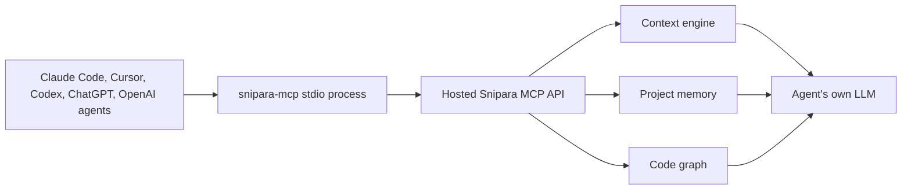

# snipara-mcp

[](https://pypi.org/project/snipara-mcp/)
[](https://www.python.org/downloads/)
[](https://opensource.org/licenses/MIT)
[](https://github.com/alopez3006/snipara-mcp/actions/workflows/ci.yml)

`snipara-mcp` is the lightweight stdio MCP connector for the Snipara Project
Brain.

**Snipara is the Project Brain for AI coding agents.**

Use it when an MCP client needs a local stdio process that talks to Snipara's
hosted Project Intelligence APIs. Snipara gives Claude Code, Cursor, Codex, and
other MCP clients the decisions, active work, code impact, proof, and handoffs
they need before they edit. If your client supports streamable HTTP MCP
directly, prefer the hosted endpoint and skip the local process.

## Choose the connection

| Client capability | Recommended path |
| --- | --- |
| Streamable HTTP MCP | Connect directly to `https://api.snipara.com/mcp/YOUR_PROJECT_SLUG` |
| Local stdio process only | Use this Python connector with its documented environment |
| Guided workspace setup | `npx create-snipara@latest` |
| Local task tracking without Hosted | [Companion](https://github.com/Snipara/snipara-companion) |

Resolve the project endpoint from your authorized setup. Supply credentials
through the client's supported environment or secret mechanism, and check a
source citation after connecting. Installing the connector does not select a
project, upload documents or install Companion, Orchestrator or Sandbox.

## What Is Snipara?

Snipara is the shared Project Intelligence layer for AI-assisted software work.

It gives Claude Code, Cursor, Codex, OpenAI Agents, and other MCP-compatible
clients project context that survives sessions, users, tools, and
model switches.

Your agent still uses its own LLM. Snipara gives it the right project context:
source-backed docs, reviewed memory, shared guidance, workflow continuity, and
code graph structure. In category terms, it is an AI coding agent context,
memory, and continuity platform.

## Why MCP?

MCP is becoming a standard adapter layer for agent tools. `snipara-mcp` makes
Snipara available through that layer without forcing developers into a specific
IDE, model, or orchestration framework.

The integration should feel small:

```bash
uvx snipara-mcp
```

The impact is larger: agents can retrieve durable project context instead of
starting cold every session.

## What It Unlocks

| Need                                      | Snipara MCP tool group                                                                  |
| ----------------------------------------- | --------------------------------------------------------------------------------------- |
| Ask project docs a source-backed question | `snipara_context_query`, `snipara_get_chunk`                                            |
| Recall durable decisions and learnings    | `snipara_recall`                                                                        |
| Review the team Inbox                     | `snipara_inbox_review_queue`, `snipara_inbox_review_plan`, `snipara_inbox_review_apply` |
| Persist reusable memory after a task      | `snipara_remember_if_novel`, `snipara_end_of_task_commit`                               |
| Reuse team standards and shared guidance  | `snipara_shared_context`                                                                |
| Inspect structural code relationships     | `snipara_code_callers`, `snipara_code_imports`, `snipara_code_neighbors`                |
| Plan risky code changes                   | `snipara_code_symbol_card`, `snipara_code_impact` within plan capacity                  |

Public MCP clients must use the `snipara_*` names. The `rlm_*` compatibility
aliases were removed from the distributed contract on 2026-08-16 and remain
only as internal handler identifiers. This contract cleanup is staged for the
next package release; clients using legacy names must migrate before upgrading.

The stdio server advertises the same compact default agent contract as the
hosted MCP endpoint. Set `SNIPARA_TOOL_PROFILE=full` only for clients that need
direct discovery of every specialist compatibility tool; hidden tools remain
callable by explicit name and discoverable through `snipara_help`.

The default discovery surface contains 13 coherent tools:
`snipara_context_query`, `snipara_ask`, `snipara_search`, `snipara_read`,
`snipara_stats`, `snipara_help`, `snipara_get_chunk`, `snipara_recall`,
`snipara_remember_if_novel`, `snipara_end_of_task_commit`,
`snipara_inbox_review_queue`, `snipara_inbox_review_plan`, and
`snipara_inbox_review_apply`.

### Minimum-safe-change review (2.8.30)

The packaged `snipara_context_query` and `snipara_code_impact` contracts now
accept `minimum_change_mode="review"`. When enabled, answer packs and impact
responses carry a non-blocking, evidence-first receipt covering existing
capabilities, stdlib/native options, installed dependencies, the smallest safe
diff, and validation-surface preservation. The policy is advisory and remains
opt-in until project evidence calibrates stronger enforcement.

Callers may provide bounded `minimum_change_evidence` with named provenance
such as `runtime`, `manifest`, `lockfile`, `git_diff`, or `test_runner`.
Unverified `confirmed` claims remain visible as `asserted`; `confirmed` is
reserved for a versioned, fingerprint-matching adapter receipt. The verified
adapters are `lockfile_manifest` for direct installed dependencies and
`git_diff` for a coherent local smallest-safe-diff check.
Responses also include non-blocking preservation guards for validation, errors,
auth/security, accessibility, public contracts, and tests.

### Semantic rule contract (2.8.27)

The generated `snipara_code_symbol_card` and `snipara_code_impact` schemas now
forward bounded `semantic_rules` project overrides to the hosted service. Terms
are literal strings rather than executable regular expressions.

### MCP transport security floor (2.8.26)

The connector now requires MCP Python SDK 1.28.1 or newer. This incorporates
the upstream fixes for authenticated-principal session isolation, experimental
task ownership, and WebSocket Host/Origin validation.

### Configurable code-impact traversal (2.8.25)

The packaged `snipara_code_impact` contract now exposes `depth` (1-6),
`direction` (`in`, `out`, or `both`), and optional `edge_kinds`. This keeps the
connector contract aligned with hosted impact chains and Companion's hybrid
local/hosted traversal controls.

### Credential-free discovery and compact contract (2.8.24)

MCP clients and directory inspectors can now complete `initialize` and
`tools/list` before credentials are configured. Every actual tool call still
fails closed until authentication and project selection are present. The
default `tools/list` response exposes the same 13-tool core as hosted Snipara,
while `SNIPARA_TOOL_PROFILE=full` retains direct discovery of all specialist
compatibility tools. Core tools now include complete selection guidance,
behavior annotations, and nested parameter documentation for safer agent use.

### Agent-readable tool contracts (2.8.23)

The connector now preserves detailed tool descriptions and MCP behavior
annotations from the hosted source of truth. Summary, coordination, state,
memory, and code graph tools explain their prerequisites, access rules, side
effects, idempotence, alternatives, parameters, outputs, and common failure
modes so agents can choose them safely. Native output schemas remain deferred
until the transport and structured result format upgrade together.

### Unified conversational Inbox review (2.8.22)

Human team admins can list the same memory candidates and `ProjectDecision`
drafts shown by the multi-project Dashboard Inbox, create evidence-backed
approve/reject/needs-human recommendations, and atomically apply an explicitly
authorized snapshot. The service revalidates the human team-admin identity,
project ownership, current candidate states, and immutable item snapshots before
recording authority audits. Real credentials remain addressable for rejection
but are redacted from MCP output. The earlier ProjectDecision-only tools remain
available as specialist compatibility tools.

### Conversational decision review (2.8.21)

Agents can list pending `ProjectDecision` drafts, propose evidence-backed
approve/reject/needs-human recommendations, and apply an explicitly authorized
snapshot-bound plan. Apply requires a human project admin and fails closed if a
draft changed after planning; there is no live wildcard approval.

### Structured Why Capture task commits (2.8.20)

`snipara_end_of_task_commit` now accepts an atomic `why` block with `decision`,
`rationale`, `alternatives`, `constraints`, and `observed_outcome`. Structured
candidates stay pending until human review, and unknown parameters fail closed
instead of being silently ignored.

### Retrieval outcome controls (2.8.19)

The stdio connector forwards the hosted server's bounded retrieval-outcome
controls for `context_query` and `recall`: optional task correlation, shadow or
enabled rerank requests, and the strict context attribution window. The hosted
server remains authoritative, so a client request can lower or disable the
configured mode but cannot escalate it.

## Architecture



## Hosted HTTP Or Stdio?

Use the hosted HTTP endpoint when your MCP client supports streamable HTTP:

```json
{
  "mcpServers": {
    "snipara": {
      "type": "http",
      "url": "https://api.snipara.com/mcp/your-project-id-or-slug",
      "headers": {
        "Authorization": "Bearer snp-your-key"
      }
    }
  }
}
```

Use `snipara-mcp` when your client expects a local stdio command:

```json
{
  "mcpServers": {
    "snipara": {
      "command": "uvx",
      "args": ["snipara-mcp"],
      "env": {
        "SNIPARA_API_KEY": "snp-your-key",
        "SNIPARA_PROJECT_ID": "your-project-id-or-slug"
      }
    }
  }
}
```

Decision rule:

- HTTP MCP first for modern clients
- `snipara-mcp` for stdio-only clients or local compatibility
- `create-snipara` when you want guided setup across clients and templates

## Install

No local install:

```bash
uvx snipara-mcp
```

Python package:

```bash
pip install snipara-mcp
```

With RLM Runtime helper integration:

```bash
pip install "snipara-mcp[rlm]"
```

## Quickstart

Sign in through the browser:

```bash
pip install snipara-mcp
snipara login
```

Initialize a project:

```bash
snipara init
```

The initializer detects common project files, writes MCP configuration, and can
upload local project docs when you are authenticated.

Useful options:

```bash
snipara init --slug my-project
snipara init --dry-run
snipara init --no-upload
snipara init --skip-test
```

## Claude Code

```bash
claude mcp add snipara uvx snipara-mcp
```

Then export credentials in your shell:

```bash
export SNIPARA_API_KEY="snp-your-key"
export SNIPARA_PROJECT_ID="your-project-id-or-slug"
```

## Cursor

Add to `~/.cursor/mcp.json`:

```json
{
  "mcpServers": {
    "snipara": {
      "command": "uvx",
      "args": ["snipara-mcp"],
      "env": {
        "SNIPARA_API_KEY": "snp-your-key",
        "SNIPARA_PROJECT_ID": "your-project-id-or-slug"
      }
    }
  }
}
```

## Environment

| Variable               | Required                                 | Description                                               |
| ---------------------- | ---------------------------------------- | --------------------------------------------------------- |
| `SNIPARA_API_KEY`      | Yes, unless using `snipara login`        | Snipara API key                                           |
| `SNIPARA_PROJECT_ID`   | Yes, unless using `SNIPARA_PROJECT_SLUG` | Project identifier                                        |
| `SNIPARA_PROJECT_SLUG` | Yes, unless using `SNIPARA_PROJECT_ID`   | Project slug                                              |
| `SNIPARA_API_URL`      | No                                       | Defaults to `https://api.snipara.com`                     |
| `SNIPARA_TOOL_PROFILE` | No                                       | `core` by default; `full` exposes specialist tool schemas |

OAuth tokens created by `snipara login` are stored in `~/.snipara/tokens.json`.
If a project id or slug is set, the connector selects the matching token and
does not silently fall back to another project.

## What You Get

The connector exposes the same compact default MCP contract as the hosted
backend. The packaged full compatibility surface is generated from the server
source of truth and is available with `SNIPARA_TOOL_PROFILE=full`.

Common tool groups:

- retrieval: `snipara_context_query`, `snipara_search`, `snipara_get_chunk`,
  `snipara_load_document`
- durable memory: `snipara_recall`, `snipara_remember`,
  `snipara_memory_compact`
- owner-aware bootstrap: `snipara_session_memories`,
  `snipara_owner_profile_get`, `snipara_owner_profile_update`
- shared context: `snipara_shared_context`, collection and template tools
- document upload: `snipara_upload_document`, `snipara_sync_documents`
- project setup: client, project, and business-context workspace tools
- operations: `snipara_settings`, `snipara_index_health`, `snipara_reindex`
- code graph: `snipara_code_*` tools when code indexes are available
- coordination: swarm, hierarchical task, and state tools when enabled

Tool availability can vary by plan, hosted deployment, and project index state.

## CLI Commands

| Command          | Description                               |
| ---------------- | ----------------------------------------- |
| `snipara login`  | Browser login and token setup             |
| `snipara init`   | Initialize Snipara in the current project |
| `snipara logout` | Clear stored tokens                       |
| `snipara status` | Show auth and project status              |
| `snipara-mcp`    | Run the MCP stdio server                  |

Legacy aliases such as `snipara-init`, `snipara-mcp-login`,
`snipara-mcp-logout`, and `snipara-mcp-status` are still supported.

## Relationship To Other Repos

| Repo                        | Role                                                  |
| --------------------------- | ----------------------------------------------------- |
| `alopez3006/snipara-mcp`    | Current generated public connector mirror             |
| `Snipara/snipara-companion` | Local workflow, impact, verification, and handoff CLI |
| `Snipara/snipara-memory`    | Open memory primitives and schema                     |

`snipara-mcp` is intentionally thin. It should be easy to install, easy to
audit, and boring to operate. The heavy lifting stays in Snipara's hosted
context and memory engine.

## Development

```bash
pip install -e ".[dev]"
pytest
ruff check .
```

The source of truth for the generated tool contract lives in the Snipara
server. When backend tools change, regenerate the packaged contract before
publishing this package.

## License

MIT. See [LICENSE](LICENSE).

### Conceptual research with bounded query plans (2.8.39)

`snipara_context_query` accepts up to four optional `retrieval_queries` authored
by the agent. Describe concrete mechanisms, capabilities, constraints and
counterevidence in the source language. Keep the original question in `query`
and preserve named entities. The hosted server combines ranked sources within
one strict `max_tokens` budget, including Answer Packs and chunk references.
Facets are hypotheses, not facts; unsupported claims remain unknown. The server
does not run its own LLM to generate the plan. Existing calls remain compatible
when the optional field is omitted.

### 3.0 context-query migration

The primary text block of a default stdio `snipara_context_query` response is
compact JSON. Session context may appear in a separate text block. Retrieved
sources, citations and caveats are preserved, with Answer Packs and automatic
query decomposition disabled by default. Consumers that parsed the previous Markdown
response should request `include_metadata=true` to use the full response format.
That full mode retains the previous defaults; set `include_answer_pack=false`
and `auto_decompose=false` explicitly if you only need source retrieval.

In compact mode, request `include_answer_pack=true` or `auto_decompose=true` only
when needed. `max_tokens` bounds the selected retrieval content, not the complete
serialized MCP response. Smaller responses do not establish better answer accuracy
or lower end-to-end latency.

### 3.0 memory context contract

Recall accepts up to four `retrieval_queries` for source-language translations or
question facets. Owner scope, minimum relevance and final result limits still apply.

Recall defaults to `memory_view="current"`: active, currently effective candidates;
source observations are checked against their accessible source on this read.
Choose retained history explicitly when asking about an earlier state:

```python
snipara_recall(query="workflow status", memory_view="current")
snipara_recall(
    query="workflow status",
    memory_view="history",
    as_of="2026-10-25T10:00:00Z",
)
```

The equivalent CLI options are `snipara recall "workflow status" --memory-view history
--as-of 2026-10-25T10:00:00Z`, or `snipara-companion recall --query "workflow status"
--memory-view history --as-of 2026-10-25T10:00:00Z --json`. Query prose alone does not
select a historical view. `as_of` requires history and a past timestamp with a
timezone. Current access, owner scope and retention/TTL still apply: history never
restores expired/deleted content or reconstructs unavailable mutable source versions.
Stored source-observation receipts can support an earlier recorded assertion;
their integrity hashes do not cryptographically authenticate origin, and older
records may predate the reserved-writer guard. Generic evidence attachment cannot
write the reserved observation descriptor/receipt namespace. Historical receipts grant
no current authority, current handoff evidence or check reuse. Historical authority
is marked ineligible for current use, without declaring the old evidence false or
changing stored lifecycle/review state. Conflicting explicit checkpoints retain an
unresolved conflict rather than a winner selected by recency.

Default calls remain compatible with older servers. For explicit history/as-of,
these clients refuse a missing or mismatched `temporal_context` confirmation rather
than silently accepting a current result. Candidate selection combines the bounded
recent pool with bounded literal recovery; neither a successful source check nor
an empty result establishes that no older relevant memory exists.

`snipara_resume_context(mode="context")` returns `agent-resume-context-v2` with freshly
verified project observation references. Pass `memory_ids` cited by the producer;
missing, inaccessible, withdrawn or over-budget evidence yields an abstention and
an automatic recovery action. Calls without mode or source/proposal fields retain
the historical continuity contract, including Companion branch/files/token-budget
arguments. `mode="continuity"` explicitly selects it. Memory IDs imply context
mode, while explicit continuity rejects source/proposal fields. Never treat
continuity history as current source or execution proof.
The 3.0.0 contract also accepts `proposed_actions` on resume. Submit the
model's plan before consuming it; the hosted validator automatically blocks check
reuse and proposes evidence recovery without execution authorization. Memory recall
now uses optional facets only for weak or ambiguous initial rankings; counters
remain in telemetry. This does not intercept external tools invoked outside the
Snipara contract.
Context-refresh proposals also expose whether their target exactly resolves to an
already-loaded verified memory/source locator. Unresolved free text stays advisory;
resolution performs no refresh and grants no execution authority.

The unpublished compact `validate_actions` beta is withdrawn from the advertised
contract after reader precision regressions. Old beta calls automatically fall
back to source-verified context and return `resumeContext`; this fallback provides
no zero-read/token-saving guarantee. Use `mode="context"` for current facts and
proposal validation. Responses expose current allowed citation IDs; optional
`proposed_citations` checks membership, never the truth of the answer's claims.
The two behaviors are `continuity` and `context`; the schema retains
`validate_actions` as a deprecated alias for context. The client remains unpublished.
